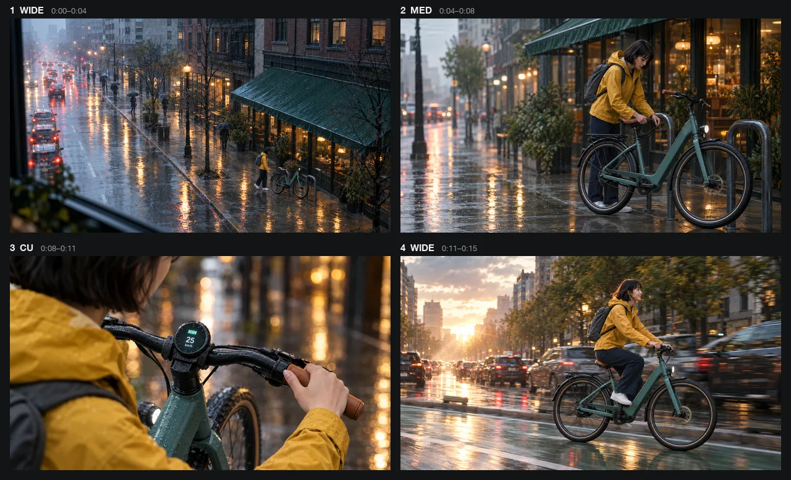

# AI Storyboard Generator Skill

[English](./README.md) | [简体中文](./README.zh-CN.md) | 日本語

> 👉 こちらもどうぞ [Viral Video Remake Skill](https://github.com/beatra-ai/viral-video-remake-skill)

台本、シーン、広告ブリーフから、実用的なショットリストと 1〜4 枚の絵コンテ用キーフレーム画像を作成。Claude Code、Cursor、Codex、Windsurf、Cline、OpenClaw のどれからでもそのまま使えます。

> [!IMPORTANT]
> 生成には [Beatra](https://beatra.ai?utm_source=github&utm_medium=flagship&utm_campaign=ai-storyboard-generator-skill) アカウントが必要で、クレジットを消費します。スキル自体のインストールは無料です。

| 項目 | 内容 |
| --- | --- |
| **できること** | 台本・シーン・広告ブリーフから、使えるショットリストと1〜4枚のキーフレーム画像を作成します。 |
| **モデル** | Qwen Image 2.0 Fast、Qwen Image 3.0、Qwen Image 3.0 Pro、GPT Image 2.5 Flare、GPT Image 2.5 Sunburst、GPT Image 2、Wan Image 2.7 Fast、Qwen Image 2.0 Pro、Wan Image 2.7 Pro、MiniMax Image 01 Live |
| **動作要件** | Python 3.10 以上と、`SKILL.md` を読み込めるエージェント |
| **費用** | インストールは無料。生成のたびに Beatra アカウントのクレジットを消費しますが、課金されるのは、その生成を明示的に依頼したとき、または確認カードを承認したときだけです。 |
| **対応エージェント** | Claude Code、Cursor、Codex、Windsurf、Cline、OpenClaw |

<p align="center"></p>

*架空の通勤用 e バイク Voltline の 15 秒広告の 4 ショット絵コンテ。雨の朝のワイドショットから、渋滞を抜けて朝日の中を走るカットまで、毎フレーム同じライダーと自転車。Beatra AI で生成。*

| Skill | Entry point | Version |
| --- | --- | --- |
| [`ai-storyboard-generator`](skills/ai-storyboard-generator) | [SKILL.md](skills/ai-storyboard-generator/SKILL.md) | 0.2.8 |

このリポジトリは [beatra-ai/beatra-skills](https://github.com/beatra-ai/beatra-skills/tree/main/skills/ai-storyboard-generator) から自動的に公開されています。問題の報告はそちらへお願いします。

## インストール

[`skills`](https://skills.sh) CLI を使う場合：

```bash
npx skills add beatra-ai/ai-storyboard-generator-skill
```

Claude Code プラグインとして：

```bash
claude plugin marketplace add beatra-ai/ai-storyboard-generator-skill
claude plugin install ai-storyboard-generator@ai-storyboard-generator-skill
```

Codex プラグインとして：

```bash
codex plugin marketplace add beatra-ai/ai-storyboard-generator-skill
codex plugin add ai-storyboard-generator@ai-storyboard-generator-skill
```

GitHub Copilot CLI プラグインとして：

```bash
copilot plugin marketplace add beatra-ai/ai-storyboard-generator-skill
copilot plugin install ai-storyboard-generator@ai-storyboard-generator-skill
```

Gemini CLI 拡張機能として：

```bash
gemini extensions install https://github.com/beatra-ai/ai-storyboard-generator-skill
```

GitHub CLI を使う場合：

```bash
gh skill install beatra-ai/ai-storyboard-generator-skill ai-storyboard-generator
```

または、このリポジトリをクローンして `skills/ai-storyboard-generator` を次の場所にコピーします：Claude Code は `~/.claude/skills/`、Cursor は `~/.cursor/skills/`、Codex は `~/.agents/skills/`、Windsurf は `~/.codeium/windsurf/skills/`、Cline は `~/.cline/skills/`、OpenClaw は `~/.openclaw/skills/`。

または、次の文をエージェントに貼り付けてください：

```text
https://github.com/beatra-ai/ai-storyboard-generator-skill から ai-storyboard-generator スキル（フォルダ skills/ai-storyboard-generator）をインストールし、その SKILL.md に従って私の Beatra アカウントに接続してください。
```

## 技術仕様と出力上限

2026-10-18 時点。最新の一覧：https://docs.beatra.ai/ja/docs/models

- **アップロード** — 1 ファイルあたり最大 100 MB。下記の各モデルの入力制限も適用されます
- **テキストから画像** — 10 モデル（Qwen Image 2.0 Fast、Qwen Image 3.0、Qwen Image 3.0 Pro、GPT Image 2.5 Flare、GPT Image 2.5 Sunburst、GPT Image 2、Wan Image 2.7 Fast、Qwen Image 2.0 Pro、Wan Image 2.7 Pro、MiniMax Image 01 Live）／PNG／1 リクエストあたり最大 4 枚／キャンバス最大 16.8 MP
  - 16.8 MP（4K ティア）：Wan Image 2.7 Pro（1 リクエストあたり最大 4 枚）／GPT Image 2.5 Flare、GPT Image 2.5 Sunburst、GPT Image 2（1 リクエストにつき 1 枚）
- **画像から画像** — 10 モデル（Qwen Image 2.0 Fast、Qwen Image 3.0、Qwen Image 3.0 Pro、Wan Image 2.7 Fast、Qwen Image 2.0 Pro、Wan Image 2.7 Pro、GPT Image 2.5 Flare、GPT Image 2.5 Sunburst、GPT Image 2、MiniMax Image 01 Live）／PNG／1 リクエストあたり最大 4 枚／キャンバス最大 16.8 MP
  - 16.8 MP（4K ティア）：GPT Image 2.5 Flare、GPT Image 2.5 Sunburst、GPT Image 2（1 リクエストにつき 1 枚）
  - 入力画像：1 リクエストあたり最大 4 枚、各 10〜20 MB／BMP、GIF、JPEG、PNG、TIFF、WEBP
- **画像編集** — 6 モデル（Qwen Image 2.0 Fast、Qwen Image 3.0、Qwen Image 3.0 Pro、Wan Image 2.7 Fast、Qwen Image 2.0 Pro、Wan Image 2.7 Pro）／PNG／1 リクエストあたり最大 4 枚／キャンバス最大 4.2 MP
  - 4.2 MP（2K ティア）：Qwen Image 2.0 Fast、Qwen Image 3.0、Qwen Image 3.0 Pro、Wan Image 2.7 Fast、Qwen Image 2.0 Pro、Wan Image 2.7 Pro（1 リクエストあたり最大 4 枚）
  - 入力画像：1 リクエストあたり最大 4 枚、各 10〜20 MB／BMP、GIF、JPEG、PNG、TIFF、WEBP

## 得られるもの

- **生成前に設計** — 各ビート、画角、構図、カメラ意図、尺、セリフ、音を先に定義し、視覚化の手戻りを減らします。
- **重要なカットだけを画像化** — 全体のショットリストから1〜4カットを選び、確認しやすく焦点の合った絵コンテにします。

## 活用シーン

- **短編と縦型ドラマ** — シーンを連続するショットへ分解し、ビート、カメラ、尺、つながりを整理します。
- **広告コンセプト** — 商品メッセージ、導入のフック、主要アクション、締めの画を比較できる流れにします。
- **アニメと企画提案** — 本制作の前に、構図、キャラクター配置、場所、視覚リズムを共有します。

## よくある質問

### 完成した脚本が必要ですか？

主要な動き、対象視聴者、想定形式が分かれば、シーン概要や広告ブリーフから始められます。

### 絵コンテ画像は何枚作れますか？

全体のショットリストを設計した後、選択した1〜4カットを個別のキーフレームとして作成します。

### キャラクターやロケーションの参考画像は使えますか？

はい。各画像の役割と順序を明確にすると、選択したフレームに意図した視覚方向を反映できます。

## 更新とセキュリティ

2026 年 10 月のリリース以降、このスキルに自動更新機能はありません。インストールしたファイルだけを実行し、
自動的に置き換えることはありません。更新はインストールに使ったツール（`npx skills update ai-storyboard-generator` または
`gh skill update ai-storyboard-generator`）で行ってください。詳細はスキル内の `references/updates-and-security.md` を参照してください。

## ライセンス

[MIT-0](LICENSE)：商用を含め、自由に使用・改変・再配布できます。クレジット表記は不要です。ClawHub 上のこれらのスキルと同じ条件です。

## リンク

- ウェブサイト — https://beatra.ai?utm_source=github&utm_medium=flagship&utm_campaign=ai-storyboard-generator-skill
- ドキュメント — https://docs.beatra.ai?utm_source=github&utm_medium=flagship&utm_campaign=ai-storyboard-generator-skill
- コンソール — https://console.beatra.ai
- AI エージェント向け — https://beatra.ai/llms.txt （インデックス）· https://beatra.ai/llms-full.txt （全スキルを 1 ファイルに）
